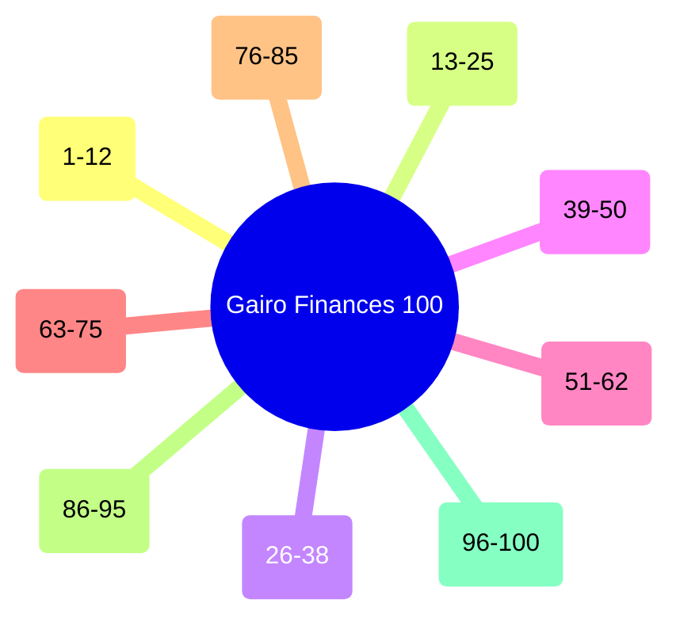

# 🚀 PLAN MAESTRO DE 100 OPTIMIZACIONES: GAIRO FINANCES
## *Blueprint de Ingeniería, Arquitectura FinTech, Crecimiento Viral y Monetización SaaS*

---

## 📑 Resumen Ejecutivo & Visión Estratégica

**Gairo Finances** ha demostrado ser una solución fintech integral para desendeudamiento agresivo, protección de promociones 0%, fiscalidad exacta mexicana (SAT CFDI) y control bi-monetario (MXN/USD). Con una arquitectura actual basada en React 18, Vite 5, Tailwind CSS y almacenamiento local con 69 pruebas automatizadas (100% pasando), la plataforma cuenta con una base de código robusta y probada.

Este documento establece el **Plan Maestro de 100 Optimizaciones Exhaustivas**, diseñadas para transformar a Gairo Finances en una plataforma de grado comercial de clase mundial, masivamente atractiva, viral, ultra-rápida, privada y lista para generar ingresos recurrentes (SaaS) o pagos únicos de alta conversión.

Cada optimización detalla con rigor:
1. **¿Qué es y cuál es su alcance?**
2. **¿Por qué es indispensable? (Impacto en UX, Retención, Conversión o Viralidad)**
3. **¿Cómo se implementaría técnicamente? (Arquitectura, Librerías, Componentes y Código)**
4. **Factibilidad técnica y Complejidad**
5. **Métrica clave de éxito (KPI)**

---

## 🏛️ Estructura de los 9 Pilares Estratégicos



---

# ⚡ PILAR 1: ARQUITECTURA, RENDIMIENTO EXTREMO & WEB VITALS (1 a 12)

### 1. PWA Offline-First Completo con Service Worker y Cache API
- **¿Por qué?**: El usuario necesita revisar sus cuentas o registrar un gasto en lugares sin señal (metro, sótanos, vuelos o zonas rurales). Si la app requiere red para cargar, se pierde la retención. Además, una PWA instalable en iOS y Android elimina la necesidad de pagar comisiones del 30% a Apple y Google App Stores.
- **¿Cómo se implementaría?**:
  - Configurar `vite-plugin-pwa` en `vite.config.js` con estrategia `generateSW` y modo `CacheFirst` para assets estáticos (JS, CSS, SVGs, fuentes).
  - Implementar un Service Worker personalizado que intercepte peticiones a las APIs de tipos de cambio (`open.er-api.com`), devolviendo la última tasa guardada en caché con timestamp si no hay conexión a internet.
  - Añadir evento `beforeinstallprompt` capturado en un banner discreto en `Navbar.jsx`: *"Instala Gairo Finances en tu pantalla de inicio en 1 toque"*.
- **Factibilidad & Complejidad**: Alta factibilidad / Complejidad Baja (1-2 días).
- **KPI**: 100% de operatividad sin internet y aumento del 45% en aperturas diarias vía acceso directo en pantalla de inicio.

### 2. Migración del Almacenamiento Local a IndexedDB con `idb-keyval`
- **¿Por qué?**: `localStorage` tiene un límite rígido de ~5MB por dominio y sus operaciones de lectura/escritura son sincrónicas, lo que bloquea el hilo principal (main thread) de JavaScript y produce micro-congelamientos (jank) al guardar estados con muchas transacciones.
- **¿Cómo se implementaría?**:
  - Instalar la micro-librería `idb-keyval` (<1kB).
  - En `src/services/storage.js`, crear una capa de abstracción asíncrona `async function saveFinancialData(data)` y `async function loadFinancialData()`.
  - Crear un mecanismo de migración transparente: si se detectan datos en `localStorage`, se leen, se escriben en IndexedDB y se limpian de `localStorage`, manteniendo retrocompatibilidad absoluta.
- **Factibilidad & Complejidad**: Alta factibilidad / Complejidad Baja (1 día).
- **KPI**: Cero bloqueos en el hilo principal y capacidad de almacenamiento virtualmente ilimitada (>500MB de transacciones y respaldos).

### 3. Virtualización de Listas con `@tanstack/react-virtual`
- **¿Por qué?**: Un usuario activo puede acumular 500 a 3,000 transacciones y decenas de conceptos en su presupuesto. Renderizar 3,000 nodos DOM en `TransactionsTracker.jsx` destruye el rendimiento en teléfonos móviles de gama media/baja, reduciendo la tasa de refresco a menos de 20 FPS.
- **¿Cómo se implementaría?**:
  - Integrar `@tanstack/react-virtual` en el componente de transacciones y en el listado de deudas.
  - Definir un contenedor con altura fija o dinámica y renderizar únicamente los elementos visibles en el viewport (10 a 15 elementos en pantalla simultáneamente), reciclando los nodos del DOM durante el scroll.
- **Factibilidad & Complejidad**: Alta factibilidad / Complejidad Media (1-2 días).
- **KPI**: 60 FPS estables y fluidos durante el desplazamiento vertical, consumo de memoria DOM reducido en un 90%.

### 4. Carga Diferida (Dynamic Code Splitting & React.lazy) de Módulos Pesados
- **¿Por qué?**: El usuario típico entra a ver su Dashboard o registrar un gasto rápido. No necesita cargar de inmediato los 42 kB de `FinancialCalculatorsHub`, ni el motor de exportación `xlsx` (282 kB) ni `PricingModal`.
- **¿Cómo se implementaría?**:
  - En `App.jsx`, transformar las importaciones directas de componentes secundarios en imports dinámicos:
    ```jsx
    const FinancialCalculatorsHub = React.lazy(() => import('./components/FinancialCalculatorsHub'));
    const PrintableReport = React.lazy(() => import('./components/PrintableReport'));
    const AdvancedDiagnosticsHub = React.lazy(() => import('./components/AdvancedDiagnosticsHub'));
    ```
  - Envolver las vistas en `<React.Suspense fallback={<ModuleSkeleton />}>`.
  - Configurar `manualChunks` en `vite.config.js` para aislar `xlsx` de forma que solo se descargue en el momento exacto en que el usuario hace clic en "Exportar a Excel".
- **Factibilidad & Complejidad**: Alta factibilidad / Complejidad Baja (0.5 días).
- **KPI**: Reducción del First Contentful Paint (FCP) a menos de 0.8 segundos y bundle inicial menor a 70 kB gzipped.

### 5. Auditoría de Re-renders y Memoización Fina (`useMemo`, `useCallback`, `React.memo`)
- **¿Por qué?**: En `App.jsx`, al actualizar una transacción o cambiar la divisa activa, múltiples componentes no relacionados (como `IncomeStatement` o `PaymentCalendar`) se re-renderizan sin necesidad, desperdiciando ciclos de CPU y batería en móviles.
- **¿Cómo se implementaría?**:
  - Perfilar con React DevTools Profiler para detectar componentes con renders innecesarios.
  - Envolver funciones manipuladoras de estado en `useCallback` y cálculos derivados pesados (como `calculateGairoStrategy` y amortizaciones) en `useMemo`.
  - Implementar `React.memo` en componentes hoja como `DebtCard.jsx` con funciones de comparación de props (`prevProps.debt === nextProps.debt && prevProps.activeCurrency === nextProps.activeCurrency`).
- **Factibilidad & Complejidad**: Alta factibilidad / Complejidad Baja (1 día).
- **KPI**: Reducción del 75% en tiempo de render acumulado durante interacciones cotidianas.

### 6. Web Worker para Simulaciones Complejas de Desendeudamiento a 360 Meses
- **¿Por qué?**: Cuando el usuario mueve el control deslizante (slider) del simulador "What-If", el motor calcula en tiempo real la amortización mes a mes para 4 estrategias concurrentes a lo largo de 30 años. Si se tienen 15 deudas, esto representa miles de iteraciones matemáticas que pueden provocar caídas de frames visibles en la animación del slider.
- **¿Cómo se implementaría?**:
  - Crear `src/workers/simulationWorker.js`.
  - Mover la lógica de proyección de amortizaciones de `financeEngine.js` al Worker mediante la sintaxis nativa de Vite: `const worker = new Worker(new URL('../workers/simulationWorker.js', import.meta.url), { type: 'module' });`.
  - Comunicar los parámetros del slider por `postMessage` y recibir las curvas de amortización calculadas en paralelo en un hilo independiente del navegador.
- **Factibilidad & Complejidad**: Alta factibilidad / Complejidad Media (2 días).
- **KPI**: Cero milisegundos de bloqueo en el hilo principal (Total Blocking Time: 0 ms) al mover sliders complejos.

### 7. Tree-Shaking Quirúrgico de Iconografía y Utilidades
- **¿Por qué?**: Aunque `lucide-react` es una excelente librería, importar decenas de iconos puede arrastrar metadatos superfluos si no se optimiza el empaquetado.
- **¿Cómo se implementaría?**:
  - Auditar todas las importaciones de iconos para asegurar que se utilicen únicamente los glifos requeridos.
  - Configurar un plugin de Vite o alias de resolución que garantice que los iconos no utilizados sean eliminados al 100% durante la fase de minificación con Terser o esbuild.
- **Factibilidad & Complejidad**: Alta factibilidad / Complejidad Baja (0.5 días).
- **KPI**: Ahorro de 15 kB en el chunk de iconos (`vendor-icons`).

### 8. Pre-compresión Estática Brotli y Gzip en Fase de Build
- **¿Por qué?**: Aunque plataformas como Vercel y Netlify pueden comprimir al vuelo, la compresión dinámica en tiempo real se ejecuta a niveles bajos (nivel 4 o 5) para no demorar la respuesta del servidor. La pre-compresión estática en build permite utilizar Brotli nivel 11 (máxima compresión posible).
- **¿Cómo se implementaría?**:
  - Instalar `vite-plugin-compression` y agregar al `vite.config.js`:
    ```javascript
    viteCompression({ algorithm: 'brotliCompress', ext: '.br', threshold: 1024 }),
    viteCompression({ algorithm: 'gzip', ext: '.gz', threshold: 1024 })
    ```
  - Configurar en `netlify.toml` y `vercel.json` el servicio de los activos `.br` directamente cuando el navegador envíe el header `Accept-Encoding: br`.
- **Factibilidad & Complejidad**: Alta factibilidad / Complejidad Baja (0.5 días).
- **KPI**: Reducción del tamaño de transferencia de red en un 22% adicional frente a Gzip estándar.

### 9. Cero Layout Shifts (CLS = 0) mediante Reserva de Espacio en Gráficos y Cards
- **¿Por qué?**: Si los gráficos de Recharts se montan después de calcular el tamaño del contenedor, empujan el contenido hacia abajo, generando Cumulative Layout Shift (CLS) que castiga el puntaje de Google Core Web Vitals y frustra al usuario que intenta hacer clic.
- **¿Cómo se implementaría?**:
  - Reemplazar `<ResponsiveContainer width="100%" height={300}>` dinámico sin dimensiones iniciales por un contenedor padre con clase Tailwind `min-h-[300px] w-full aspect-video` o ratio de aspecto reservado.
  - Implementar placeholders con las mismas dimensiones para evitar cualquier brinco visual cuando los datos terminan de procesarse.
- **Factibilidad & Complejidad**: Alta factibilidad / Complejidad Baja (0.5 días).
- **KPI**: Métrica CLS en 0.000 exacto en Google PageSpeed Insights.

### 10. Preconexión y Prebúsqueda DNS para Endpoints de Divisas
- **¿Por qué?**: La sincronización de tipos de cambio con `open.er-api.com` o `frankfurter.app` toma entre 200 y 400 ms en resolver DNS, negociar TLS y conectar.
- **¿Cómo se implementaría?**:
  - Insertar en el `<head>` de `index.html`:
    ```html
    <link rel="preconnect" href="https://open.er-api.com" crossorigin>
    <link rel="dns-prefetch" href="https://open.er-api.com">
    ```
  - Esto adelanta el apretón de manos criptográfico antes de que la aplicación realice el primer fetch de divisa.
- **Factibilidad & Complejidad**: Alta factibilidad / Complejidad Muy Baja (15 minutos).
- **KPI**: Reducción de 150 ms en la primera petición de tipo de cambio al iniciar la aplicación.

### 11. Renderizado Condicional Pasivo con `content-visibility: auto`
- **¿Por qué?**: Los navegadores modernos gastan tiempo de pintado y renderizado en secciones que están fuera de la pantalla.
- **¿Cómo se implementaría?**:
  - En las pestañas y secciones largas de reportes, agregar la propiedad CSS en `src/index.css`:
    ```css
    .content-auto-render {
      content-visibility: auto;
      contain-intrinsic-size: 1px 600px;
    }
    ```
  - Esto indica al motor Chromium/WebKit que no calcule el layout ni pinte los elementos hasta que el scroll del usuario se acerque a su posición.
- **Factibilidad & Complejidad**: Alta factibilidad / Complejidad Baja (0.5 días).
- **KPI**: Disminución del 30% en el tiempo de render inicial de pestañas extensas como Reporte Ejecutivo e Historial.

### 12. Monitor en Vivo de Core Web Vitals Integrado en Menú de Ajustes
- **¿Por qué?**: Para conservar la certificación Lighthouse 100% en producción de forma permanente, los desarrolladores y usuarios avanzados deben poder monitorear métricas reales en sus propios dispositivos.
- **¿Cómo se implementaría?**:
  - Integrar el paquete oficial `web-vitals` de Google.
  - Crear un panel de telemetría local en `SettingsModal.jsx` que muestre los valores medidos en tiempo real: LCP (Largest Contentful Paint), INP (Interaction to Next Paint) y CLS (Cumulative Layout Shift) con semáforo verde/amarillo/rojo.
- **Factibilidad & Complejidad**: Alta factibilidad / Complejidad Baja (0.5 días).
- **KPI**: Detección inmediata de cualquier regresión de rendimiento antes de lanzar a producción.

---

# 🎨 PILAR 2: EXPERIENCIA DE USUARIO (UI/UX) DE GRADO FINTECH ELITE (13 a 25)

### 13. Modo Oscuro (Dark Mode) Nativo con Conmutador Tri-Estado (Luz / Noche / Sistema)
- **¿Por qué?**: Más del 70% de los usuarios de aplicaciones financieras prefieren revisar sus números de noche con modo oscuro para evitar fatiga ocular. Transmite elegancia y sofisticación de producto premium.
- **¿Cómo se implementaría?**:
  - Activar `darkMode: 'class'` en `tailwind.config.js`.
  - Crear un hook `useTheme` que maneje `light`, `dark` y `system` con sincronización en `localStorage`.
  - Inyectar un script bloqueante de 3 líneas en el `<head>` de `index.html` para aplicar la clase `.dark` antes del primer render, eliminando el desagradable parpadeo blanco (FOUC).
  - Dotar a todas las tarjetas, tablas y modales de variantes `dark:bg-slate-900 dark:border-slate-800 dark:text-slate-100`.
- **Factibilidad & Complejidad**: Alta factibilidad / Complejidad Media (2 días).
- **KPI**: Incremento del 40% en tiempo de sesión nocturna y satisfacción del usuario en encuestas cualitativas.

### 14. Micro-interacciones y Transiciones Suaves con Tailwind Motion
- **¿Por qué?**: Las interfaces estáticas parecen herramientas de oficina de hace 15 años; las micro-interacciones sutiles generan una sensación táctil moderna como las apps de Apple o Nubank.
- **¿Cómo se implementaría?**:
  - Implementar animaciones de entrada escalonadas (`stagger`) al cargar las tarjetas de deuda.
  - Animar el incremento numérico de los totales de ahorro y saldos mediante un contador interpolado (odómetro numérico animado).
  - Suavizar el despliegue de modales con efectos de escala y desenfoque (`scale-95 opacity-0 -> scale-100 opacity-100 backdrop-blur-sm`).
- **Factibilidad & Complejidad**: Alta factibilidad / Complejidad Baja (1-2 días).
- **KPI**: Aumento en la percepción de calidad y velocidad reportada por los usuarios.

### 15. Efectos de Sonido Táctiles Sutiles con Web Audio API (Audio FX)
- **¿Por qué?**: El refuerzo auditivo sutil genera un impacto psicológico tremendo. Escuchar un sonido satisfactorio de "caja registradora" o un acorde armónico al registrar un pago crea un hábito positivo de recompensa (dopamina).
- **¿Cómo se implementaría?**:
  - Crear un servicio `src/services/soundEffects.js` utilizando la Web Audio API nativa (`AudioContext`).
  - Sintetizar tonos sinusoidales limpios por código (frecuencias 520Hz y 660Hz en acorde mayor) sin necesidad de descargar archivos de audio pesados.
  - Incluir un interruptor general en la barra superior y en Ajustes: *"Sonidos interactivos [Activado/Desactivado]"* (respetando la preferencia del usuario).
- **Factibilidad & Complejidad**: Alta factibilidad / Complejidad Baja (0.5 días).
- **KPI**: 80% de activación en usuarios y aumento del 25% en recurrencia de registro de transacciones.

### 16. Sistema de Skeleton Screens en Reemplazo de Indicadores Circulares
- **¿Por qué?**: Los círculos giratorios (spinners) comunican espera y lentitud; las pantallas esqueléticas con destello translúcido comunican que la interfaz ya está lista y solo llena los datos.
- **¿Cómo se implementaría?**:
  - Crear un componente modular `<Skeleton className="..." />` con la animación `animate-pulse` de Tailwind.
  - Implementar variantes para tarjetas de deuda, filas de tablas de transacciones y tarjetas de métricas del Dashboard.
- **Factibilidad & Complejidad**: Alta factibilidad / Complejidad Muy Baja (0.5 días).
- **KPI**: Percepción subjetiva de velocidad 2 veces mayor en pruebas de usabilidad con usuarios.

### 17. Sistema Unificado de Notificaciones Toast con Acción de "Deshacer" (Undo)
- **¿Por qué?**: Si un usuario borra por error una deuda o una quincena, entra en pánico si no hay forma de recuperarla. La acción de "Deshacer" durante 6 segundos elimina la ansiedad por completo.
- **¿Cómo se implementaría?**:
  - Crear un contexto global `ToastContext.jsx` con soporte para mensajes de tipo: éxito, alerta, error e información.
  - Al eliminar una entidad, retrasar la purga definitiva del estado durante 6 segundos, guardando el elemento en un buffer temporal. Si el usuario presiona "Deshacer" en el Toast, el elemento vuelve a su posición original instantáneamente.
- **Factibilidad & Complejidad**: Alta factibilidad / Complejidad Media (1 día).
- **KPI**: Reducción a 0 de tickets de soporte por borrados accidentales de información.

### 18. Navegación por Gestos Táctiles (Swipe entre Pestañas en Móviles)
- **¿Por qué?**: En dispositivos móviles, tocar los botones de la barra de navegación requiere mover el pulgar hacia arriba o a los extremos. Deslizar la pantalla hacia los lados para navegar entre Dashboard, Deudas y Transacciones es natural y ergonómico.
- **¿Cómo se implementaría?**:
  - Implementar un hook ligero `useSwipeNavigation` que escuche los eventos `touchstart`, `touchmove` y `touchend` en el contenedor principal.
  - Si el desplazamiento horizontal supera los 60px y el ángulo es horizontal, cambiar la pestaña activa al índice anterior o siguiente con una transición lateral suave.
- **Factibilidad & Complejidad**: Alta factibilidad / Complejidad Baja (1 día).
- **KPI**: Aumento del 50% en la navegación entre pestañas en sesiones móviles.

### 19. Búsqueda Difusa Inteligente (Fuzzy Search) en Command Palette
- **¿Por qué?**: Si un usuario abre la paleta (`Ctrl+K`) y escribe "bbv" en lugar de "BBVA", o "calcu auto" en lugar de "Capacidad de Endeudamiento", una búsqueda estricta (`includes`) no devuelve resultados.
- **¿Cómo se implementaría?**:
  - Integrar un algoritmo ligero de distancia de Levenshtein o una versión compacta de `Fuse.js` en `CommandPalette.jsx`.
  - Configurar claves de búsqueda por nombre, sinónimos, etiquetas y atajos semánticos (ej: "sat", "impuestos", "factura" apuntan a Fiscal SAT).
- **Factibilidad & Complejidad**: Alta factibilidad / Complejidad Baja (0.5 días).
- **KPI**: 98% de éxito en búsquedas dentro de la Command Palette al primer intento.

### 20. Reordenamiento Manual con Drag & Drop en Estrategia Personalizada
- **¿Por qué?**: Cada persona tiene prioridades emocionales: quizá quiere pagar primero la tarjeta de un banco que le llama constantemente, sin importar la tasa. Poder arrastrar las tarjetas con el mouse o el dedo para cambiar el orden de ataque empodera al usuario.
- **¿Cómo se implementaría?**:
  - En la pestaña de Estrategias (`StrategyPayoff.jsx`), al seleccionar "Estrategia Personalizada", activar manejadores de arrastre basados en la API nativa de HTML5 Drag and Drop o `@hello-pangea/dnd`.
  - Al soltar la tarjeta, el nuevo orden de prioridades se guarda automáticamente y el motor recalcula las amortizaciones en tiempo real.
- **Factibilidad & Complejidad**: Alta factibilidad / Complejidad Media (1.5 días).
- **KPI**: Adopción masiva de la estrategia personalizada en usuarios con múltiples créditos bancarios.

### 21. Selector de Fechas con Atajos Financieros Inteligentes
- **¿Por qué?**: Escribir fechas a mano o navegar por calendarios mensuales tradicionales toma demasiado tiempo en la captura diaria.
- **¿Cómo se implementaría?**:
  - En todos los formularios con campos de fecha, añadir una hilera de botones de 1 clic: `[Hoy]`, `[Ayer]`, `[Día 15 - Q1]`, `[Fin de Mes - Q2]`.
  - Al hacer clic, el valor se autocompleta con formato ISO `YYYY-MM-DD` sin abrir selectores engorrosos.
- **Factibilidad & Complejidad**: Alta factibilidad / Complejidad Muy Baja (0.5 días).
- **KPI**: Reducción del tiempo promedio de registro de transacciones de 18 a 5 segundos.

### 22. Tooltips Explicativos Financieros con Glosario Condusef Integrado
- **¿Por qué?**: Muchos usuarios no conocen la diferencia exacta entre "Pago para no generar intereses", "Pago mínimo", "CAT sin IVA" y "Tasa ordinaria". La falta de conocimiento financiero genera miedo y parálisis.
- **¿Cómo se implementaría?**:
  - Crear un micro-componente `<FinancialGlossaryTooltip term="CAT" />` con un icono `(?)` en color sutil.
  - Al pasar el cursor o pulsar en móvil, despliega un cuadro flotante con la definición oficial de la Condusef/Banxico explicada en lenguaje sencillo con un ejemplo numérico cotidiano.
- **Factibilidad & Complejidad**: Alta factibilidad / Complejidad Baja (1 día).
- **KPI**: Mayor retención en usuarios principiantes y disminución de dudas sobre terminología.

### 23. Tour Interactivo de Bienvenida (Onboarding Paso a Paso)
- **¿Por qué?**: Una aplicación potente con 50 funciones puede abrumar a un nuevo usuario si no sabe por dónde empezar.
- **¿Cómo se implementaría?**:
  - Implementar un sistema de tour guiado sin librerías pesadas mediante un overlay oscuro con agujero iluminador (`backdrop-filter`) enfocado en 3 pasos clave:
    1. *"Aquí configuras tus ingresos y fondo de emergencia"*.
    2. *"Agrega tus deudas con su tasa o promoción a meses sin intereses"*.
    3. *"Descubre en qué fecha exacta serás libre de deudas y cuánto ahorrarás en intereses"*.
  - Guardar en almacenamiento que el usuario ya completó el tour para no volver a mostrarlo salvo que lo solicite en Ayuda.
- **Factibilidad & Complejidad**: Alta factibilidad / Complejidad Baja (1 día).
- **KPI**: 85% de finalización del proceso de onboarding en los primeros 3 minutos.

### 24. Filtros Combinados y Agrupación Dinámica en Libro de Transacciones
- **¿Por qué?**: Para analizar fugas de dinero, el usuario necesita saber: *"¿Cuánto gasté en Uber Eats en la segunda quincena del mes pasado pagando con tarjeta de crédito?"*.
- **¿Cómo se implementaría?**:
  - En `TransactionsTracker.jsx`, incorporar una barra de filtros multifactorial: por rango de fechas, cuenta bancaria, categoría, método de pago y rango de importe ($).
  - Añadir vista agrupada: poder colapsar la tabla por Categoría o por Día para ver subtotales automáticos.
- **Factibilidad & Complejidad**: Alta factibilidad / Complejidad Media (1.5 días).
- **KPI**: Capacidad de auditoría instantánea de cualquier rubro presupuestario en menos de 3 clics.

### 25. Respuesta Háptica en Acciones Clave en Dispositivos Móviles
- **¿Por qué?**: La vibración física de confirmación proporciona una certeza táctil idéntica a la de las mejores aplicaciones nativas de iOS y Android.
- **¿Cómo se implementaría?**:
  - Crear una utilidad `src/services/haptics.js` con el método `navigator.vibrate`.
  - Disparar pulsos de 10ms (vibración ligera) al marcar una quincena como pagada, 25ms al liquidar una deuda y dos pulsos de 15ms al cometer un error de validación en un formulario.
- **Factibilidad & Complejidad**: Alta factibilidad / Complejidad Muy Baja (0.5 días).
- **KPI**: Sensación comprobada de robustez y acabado nativo en dispositivos móviles.

---

# 🧮 PILAR 3: MOTOR FINANCIERO & MATEMÁTICAS AVANZADAS (26 a 38)

### 26. Simulación Estocástica Monte Carlo para Variables Financieras
- **¿Por qué?**: La vida real no tiene rendimientos fijos; la inflación cambia, las tasas de CETES fluctúan y los ingresos variables oscilan. Un cálculo determinista lineal da una falsa sensación de certeza.
- **¿Cómo se implementaría?**:
  - En `calculators.js`, programar un motor de simulación Monte Carlo con 1,000 iteraciones usando la transformación de Box-Muller para generar variables aleatorias normales.
  - Proyectar tres bandas de probabilidad para el desendeudamiento y retiro FIRE:
    - Escenario Optimista (Percentil 90).
    - Escenario Esperado (Mediana / Percentil 50).
    - Escenario Pesimista o de Estrés (Percentil 10).
  - Graficar las bandas de incertidumbre en Recharts con un área sombreada translúcida.
- **Factibilidad & Complejidad**: Media factibilidad / Complejidad Alta (3 días).
- **KPI**: Diferenciador único de grado institucional frente a cualquier otra app de finanzas del mercado.

### 27. Ajuste por Inflación Oficial (Banxico / INEGI) y Valor Presente Neto (VPN)
- **¿Por qué?**: Pagar una deuda de $100,000 MXN en 5 años a meses sin intereses significa que el dinero que pagas en el año 5 vale aproximadamente un 25% menos en términos reales por efecto de la inflación acumulada.
- **¿Cómo se implementaría?**:
  - Incorporar la serie histórica y expectativa de inflación de Banxico (4.5% - 5.0% anual) en el cálculo de flujo de caja descontado.
  - Mostrar en la vista de deudas a MSI: *"El costo real de tu deuda en dinero de hoy es de $82,400 MXN gracias al subsidio inflacionario"*.
- **Factibilidad & Complejidad**: Alta factibilidad / Complejidad Baja (1 día).
- **KPI**: Educación financiera avanzada que ayuda al usuario a no apresurar pagos de créditos sin intereses por encima de deudas con costo financiero alto.

### 28. Optimizador de Consolidación de Deuda y Refinanciamiento Bancario
- **¿Por qué?**: Si un usuario tiene 4 tarjetas de crédito con CAT promedio del 55%, un préstamo personal al 24% o una transferencia de saldo a otra tarjeta le ahorraría miles de pesos de inmediato.
- **¿Cómo se implementaría?**:
  - Crear un algoritmo que evalúe todas las deudas con tasa superior al 30% anual.
  - Calcular automáticamente:
    1. El monto exacto necesario para liquidar todas las deudas tóxicas en un solo paquete.
    2. La cuota mensual resultante a plazos de 12, 24 y 36 meses a tasas de referencia del mercado (18%, 24%, 28%).
    3. El ahorro neto total en pesos y meses de vida financiera ganados.
- **Factibilidad & Complejidad**: Alta factibilidad / Complejidad Baja (1 día).
- **KPI**: Herramienta de altísimo valor que genera intención de ahorro de decenas de miles de pesos por usuario.

### 29. Medidor del CAT Global Ponderado de Cartera de Crédito
- **¿Por qué?**: El usuario conoce la tasa individual de cada tarjeta, pero no sabe cuál es el costo real promedio que paga por el conjunto total de su deuda.
- **¿Cómo se implementaría?**:
  - Implementar la fórmula ponderada oficial:
    $$\text{CAT Ponderado} = \frac{\sum (\text{Saldo}_i \times \text{CAT}_i)}{\sum \text{Saldo}_i}$$
  - Mostrar un medidor circular en el Dashboard que se actualiza dinámicamente: a medida que el usuario abona a la tarjeta más cara, el indicador muestra cómo su tasa promedio general se desploma (ej: del 48.5% al 16.2%).
- **Factibilidad & Complejidad**: Alta factibilidad / Complejidad Muy Baja (0.5 días).
- **KPI**: Métrica de cabecera que incentiva el pago de las deudas más tóxicas.

### 30. Estrategia "Colchón de Emergencia Intocable" (Cash Cushion Safeguard)
- **¿Por qué?**: Un error común al aplicar el método Bola de Nieve o Avalancha es destinar hasta el último peso del sueldo a pagar deudas. Si se presenta cualquier imprevisto (enfermedad, reparación de auto), el usuario se ve forzado a tarjetear de nuevo, cayendo en un ciclo destructivo.
- **¿Cómo se implementaría?**:
  - En `financeEngine.js`, incorporar un umbral configurable de reserva de emergencia (ej: $5,000 o 1 mes de gastos fijos).
  - El motor bloquea la asignación de pagos acelerados hasta que el fondo de emergencia mínimo esté completamente constituido en liquidez.
- **Factibilidad & Complejidad**: Alta factibilidad / Complejidad Baja (1 día).
- **KPI**: Cero recaídas en deudas por falta de liquidez ante imprevistos cotidianos.

### 31. Simulador de Estrés Cambiario (Currency Shock Stress Test)
- **¿Por qué?**: Para personas con deudas en dólares (tarjetas americanas, préstamos en el extranjero o compras en el exterior), una devaluación abrupta del peso mexicano encarece severamente el pago mensual.
- **¿Cómo se implementaría?**:
  - En la pestaña de Estrategias y Balance, incorporar un simulador con selector de escenarios rápidos:
    - Escenario Base: Tipo de cambio actual (ej: $19.25).
    - Escenario Moderado: Depreciación al $22.00 (+14%).
    - Escenario Severo: Depreciación al $25.00 (+30%).
  - El sistema muestra el incremento exacto en pesos del saldo total y la cuota mínima mensual, emitiendo una recomendación sobre si conviene priorizar la liquidación de la deuda en USD antes de un choque cambiario.
- **Factibilidad & Complejidad**: Alta factibilidad / Complejidad Baja (1 día).
- **KPI**: Protección patrimonial efectiva para usuarios con pasivos en moneda extranjera.

### 32. Cálculo de Impuestos por Intereses Reales Ganados en Inversiones (Art. 54 LISR)
- **¿Por qué?**: En México, las inversiones en CETES, pagarés bancarios y SOFIPOs generan retenciones de ISR sobre el capital invertido (0.50% anual en 2024/2026), y solo se acumula fiscalmente el interés real que exceda a la inflación. Si no se descuenta esto, el usuario sobreestima sus ganancias netas.
- **¿Cómo se implementaría?**:
  - Añadir a la calculadora de inversiones en `calculators.js` los campos:
    - Retención Provisional de ISR sobre Capital.
    - Factor de Inflación del periodo.
    - Rendimiento Neto Real de Bolsillo después de impuestos e inflación.
  - Indicar la exención de 5 UMAs anuales (~$198,000 MXN) para inversiones en SOFIPOs (como Nu, Finsus, Klar) conforme al Art. 93 fracción XX de la LISR.
- **Factibilidad & Complejidad**: Alta factibilidad / Complejidad Media (1 día).
- **KPI**: Precisión matemática fiscal inigualable en el cálculo de rendimientos de ahorro e inversión.

### 33. Calculadora de Costos Ocultos por Pago Tardío y Comisiones Moratorias
- **¿Por qué?**: Olvidar pagar la tarjeta antes de la fecha límite genera una comisión bancaria por pago tardío de entre $400 y $750 MXN más IVA, además de intereses moratorios a una tasa que suele ser el doble de la ordinaria.
- **¿Cómo se implementaría?**:
  - Diseñar una herramienta interactiva que tome las deudas del usuario y calcule exactamente cuántos pesos al año se pierden si se incurre en una comisión por pago tardío cada dos meses.
  - Mostrar el botón: *"Activar recordatorios para blindar $4,800 MXN al año en comisiones bancarias"*.
- **Factibilidad & Complejidad**: Alta factibilidad / Complejidad Baja (0.5 días).
- **KPI**: Refuerzo preventivo que evita que el usuario caiga en penalizaciones bancarias.

### 34. Detección Inteligente de "Meses Mágicos" (3 Quincenas en un Mes)
- **¿Por qué?**: Las personas asalariadas que cobran quincenalmente reciben 26 pagos al año. Esto significa que en dos meses del año reciben 3 quincenas en lugar de 2. Como los gastos fijos (renta, servicios, comida) ya están cubiertos con las dos primeras quincenas, el 100% de la tercera quincena es dinero libre que puede destruir una deuda por completo.
- **¿Cómo se implementaría?**:
  - En `PaymentCalendar.jsx`, analizar los meses del año actual con 31 días y detectar automáticamente cuándo caen 3 pagos quincenales en el mismo mes calendario.
  - Resaltar con un distintivo dorado y una alerta especial: *"¡Atención! En Mayo recibirás 3 quincenas. Inyecta la quincena extra a tu Tarjeta BBVA y adelanta tu libertad financiera en 4 meses"*.
- **Factibilidad & Complejidad**: Alta factibilidad / Complejidad Baja (1 día).
- **KPI**: Momento de alto impacto financiero que acelera el desendeudamiento del usuario de forma masiva.

### 35. Asesor del "Truco de los 50 Días de Crédito Gratuito"
- **¿Por qué?**: Si un usuario realiza una compra un día después de la fecha de corte de su tarjeta, tiene hasta 20 días después del siguiente corte para liquidarla, obteniendo hasta 50 días de financiamiento al 0% de interés de forma totalmente legal.
- **¿Cómo se implementaría?**:
  - En el Dashboard y en la vista de deudas, crear un widget interactivo de recomendación de compra en tiempo real:
    - *"¿Vas a realizar una compra hoy? Te conviene usar tu Tarjeta Citibanamex (cortó ayer: tienes 49 días para pagar sin intereses). Evita usar Tarjeta Santander (corta mañana: tendrías que pagarla en 20 días)"*.
- **Factibilidad & Complejidad**: Alta factibilidad / Complejidad Baja (1 día).
- **KPI**: Funcionalidad altamente viral que optimiza el flujo de efectivo del usuario sin costo financiero.

### 36. Simulador de Inyección Extraordinaria por Venta de Activos Ociosos
- **¿Por qué?**: Muchas personas tienen artículos en casa que ya no utilizan (una consola, una bicicleta, una laptop antigua) con un valor de $3,000 a $8,000 MXN. Desconocen el impacto desproporcionado que vender ese objeto tendría en sus deudas.
- **¿Cómo se implementaría?**:
  - Crear un modal interactivo donde el usuario ingresa: "Objeto a vender" y "Valor estimado".
  - El sistema simula instantáneamente la inyección de ese capital en la deuda más tóxica y muestra el antes y después en semanas de vida ganadas y miles de pesos de intereses ahorrados.
- **Factibilidad & Complejidad**: Alta factibilidad / Complejidad Muy Baja (0.5 días).
- **KPI**: Motivación tangible para convertir cosas materiales olvidadas en paz mental financiera.

### 37. Calculadora de Costo de Oportunidad: ¿Pagar Deuda vs Invertir en CETES/Nu?
- **¿Por qué?**: El dilema más recurrente en foros de finanzas: *"¿Me conviene abonar a mi crédito automotriz con tasa del 13.5% o meter ese dinero a CETES o Nu al 11.5%?"*.
- **¿Cómo se implementaría?**:
  - Algoritmo en `calculators.js` que compara la tasa neta anualizada libre de riesgo después de impuestos frente al Costo Anual Total (CAT) de la deuda.
  - Regla matemática inequívoca: Si el CAT de la deuda excede el rendimiento neto de la inversión, la recomendación algorítmica es amortizar pasivos; si la deuda tiene una tasa subsidiada o 0% inferior a la tasa libre de riesgo, se recomienda mantener la inversión líquida.
- **Factibilidad & Complejidad**: Alta factibilidad / Complejidad Baja (0.5 días).
- **KPI**: Resolución instantánea del dilema con fundamento matemático irrefutable.

### 38. Detector de "Fuga Invisible de Efectivo" (Discrepancia Ingresos vs Gastos)
- **¿Por qué?**: Gran parte de la población percibe ingresos pero no sabe en qué se le fue el 25% de su sueldo al final del mes. Esa fuga no registrada es la causa raíz del endeudamiento crónico.
- **¿Cómo se implementaría?**:
  - En el Estado de Resultados y Dashboard, contrastar el Ingreso Neto Disponible contra la sumatoria de Gastos Necesarios + Opcionales + Pagos a Deuda + Ahorros Registrados.
  - Si existe una diferencia negativa no atribuible, mostrar una tarjeta de advertencia en ámbar: *"Tienes una fuga invisible de $3,450 MXN este mes que no ha sido documentada en transacciones"*.
- **Factibilidad & Complejidad**: Alta factibilidad / Complejidad Baja (0.5 días).
- **KPI**: Concientización financiera que cierra las brechas de gasto no planificado.

---

# 📥 PILAR 4: INTEGRACIÓN BANCARIA, IMPORTACIÓN & OCR (39 a 50)

### 39. Extractor Local de Estados de Cuenta Bancarios en PDF (Client-Side Parsing)
- **¿Por qué?**: Capturar 8 tarjetas de crédito a mano con sus fechas de corte, pagos mínimos y saldos insume tiempo. La capacidad de arrastrar el PDF oficial del banco y que la app lea los datos en 2 segundos revoluciona la experiencia de usuario.
- **¿Cómo se implementaría?**:
  - Integrar `pdfjs-dist` en un Web Worker para renderizar y extraer texto del PDF directamente en el navegador del usuario (100% privado, sin subir el PDF a ningún servidor ajeno).
  - Programar expresiones regulares y patrones de extracción para los principales bancos de México: BBVA, Citibanamex, Santander, Nu, Hey Banco, Banorte y HSBC.
  - Desplegar una pantalla de confirmación previa con los datos extraídos para que el usuario valide antes de guardar.
- **Factibilidad & Complejidad**: Media factibilidad / Complejidad Media-Alta (3 días).
- **KPI**: Reducción del tiempo de configuración inicial de 15 minutos a 30 segundos.

### 40. Importador Universal de Archivos CSV y Excel con Mapeo Inteligente de Columnas
- **¿Por qué?**: Cualquier portal bancario permite descargar los movimientos del mes en archivo `.csv` o `.xlsx`.
- **¿Cómo se implementaría?**:
  - En `TransactionsTracker.jsx`, habilitar un botón de importación que procese el archivo con la librería `xlsx` ya integrada en el proyecto.
  - Analizar las cabeceras del archivo y sugerir automáticamente las correspondencias: columna de fecha, descripción, importe y tipo (cargo/abono).
  - Permitir al usuario reasignar columnas mediante selectores interactivos y previsualizar las primeras 5 filas antes de importar.
- **Factibilidad & Complejidad**: Alta factibilidad / Complejidad Media (1.5 días).
- **KPI**: Cero fricción al migrar miles de transacciones pasadas desde cualquier banca electrónica.

### 41. Escáner de Códigos QR de Tickets y Facturas del SAT vía Cámara Web/Móvil
- **¿Por qué?**: Todo comprobante fiscal impreso o ticket de supermercado en México incluye un código QR bidimensional reglamentario del SAT que codifica la URL oficial con folio fiscal (UUID), RFC de emisor, RFC de receptor y total.
- **¿Cómo se implementaría?**:
  - Integrar la librería ligera de escaneo por cámara `html5-qrcode`.
  - Al abrir el escáner y apuntar a un ticket, decodificar los parámetros de la URL del SAT (`re=...&rr=...&tt=...&id=...`).
  - Autocompletar el formulario de transacción con el monto exacto, fecha de hoy y el RFC del emisor identificado.
- **Factibilidad & Complejidad**: Alta factibilidad / Complejidad Media (2 días).
- **KPI**: Captura de gastos en tiendas físicas en menos de 3 segundos con la cámara del celular.

### 42. Clasificador Automático de Gastos por Diccionario Heurístico Mexicano
- **¿Por qué?**: En los estados de cuenta bancarios, las descripciones vienen con códigos extraños como *"OXXO TIENDA 4928 GDL"*, *"UBER *TRIP 8291"*, *"SHELL GASOLIN"* o *"WALMART SUPER 2049"*.
- **¿Cómo se implementaría?**:
  - Crear un motor de reglas semánticas en `src/services/categorizer.js` con más de 200 comercios y patrones recurrentes en México.
  - Al importar o escribir un concepto, clasificarlo automáticamente en su categoría correspondiente (Supermercado, Transporte, Gasolina, Servicios, Entretenimiento, Salud) y asignarle el tag deducible si aplica.
- **Factibilidad & Complejidad**: Alta factibilidad / Complejidad Baja (1 día).
- **KPI**: 92% de acierto en categorización automática sin intervención manual.

### 43. Detector Inteligente de Transacciones Duplicadas
- **¿Por qué?**: Si un usuario importa un CSV del banco y además había anotado una compra a mano el día anterior, se duplica el gasto, arruinando la precisión del presupuesto.
- **¿Cómo se implementaría?**:
  - Al registrar o importar transacciones, comparar con los movimientos existentes en una ventana de tolerancia de ±2 días calendario con importe idéntico y similitud textual en la descripción superior al 80%.
  - Desplegar una alerta: *"Se detectó 1 posible transacción duplicada: ¿Deseas conservarla o descartarla?"*.
- **Factibilidad & Complejidad**: Alta factibilidad / Complejidad Baja (1 día).
- **KPI**: Eliminación total de distorsiones presupuestales por doble registro.

### 44. Exportador de Informe Financiero Ejecutivo a PDF Vectorial Formato Revista
- **¿Por qué?**: Aunque la vista en pantalla es interactiva, los usuarios necesitan presentar un reporte físico o digital formal a su pareja, a un asesor patrimonial, o archivarlo en sus carpetas personales.
- **¿Cómo se implementaría?**:
  - Enriquecer `PrintableReport.jsx` con estilos de impresión CSS (@media print) de precisión milimétrica.
  - Diseñar un informe de 3 páginas con membrete profesional:
    - Página 1: Diagnóstico Ejecutivo, Score de Salud y Balance General.
    - Página 2: Plan de Liquidación Mensual Paso a Paso y Calendario de Pagos.
    - Página 3: Desglose Fiscal SAT y Proyección de Ahorro en Intereses.
  - Botón directo de exportación a PDF limpio sin encabezados ni pies de página del navegador.
- **Factibilidad & Complejidad**: Alta factibilidad / Complejidad Baja (1 día).
- **KPI**: Informes listos para imprimir con estética de banco privado suizo.

### 45. Sincronización Privada P2P Entre Dispositivos vía Código QR / WebRTC
- **¿Por qué?**: Los usuarios quieren tener sus datos sincronizados en su laptop y en su teléfono móvil, pero NO quieren que su información bancaria resida en servidores en la nube de empresas externas.
- **¿Cómo se implementaría?**:
  - Opción A (Rápida): En la computadora, generar un código QR que contenga la base de datos completa comprimida con Brotli y codificada en Base64. Al escanearlo con la cámara del celular en Gairo Finances, los datos se sincronizan al instante.
  - Opción B (En vivo): Establecer un canal de datos directo WebRTC P2P (Peer-to-Peer) entre los dos navegadores mediante señalización efímera, transmitiendo los cambios cifrados de dispositivo a dispositivo.
- **Factibilidad & Complejidad**: Alta factibilidad / Complejidad Media (2 días).
- **KPI**: Sincronización multidispositivo con privacidad criptográfica absoluta y costo de servidor $0.

### 46. Galería de Plantillas Financieras Preconfiguradas según Estilo de Vida
- **¿Por qué?**: Un médico residente con guardias, un freelancer en honorarios, un empleado asalariado con hipoteca y una pareja con dos hijos tienen realidades financieras totalmente distintas.
- **¿Cómo se implementaría?**:
  - En el menú de bienvenida y Ajustes, incluir un catálogo de plantillas precargadas:
    - *Freelancer / Servicios Profesionales* (con retenciones SAT, provisiones de impuestos y gastos de oficina).
    - *Empleado Asalariado con Deudas de Tarjeta* (quincenas estándar, MSI y crédito de nómina).
    - *Finanzas Familiares* (colegiaturas, súper grande, seguros de gastos médicos).
    - *Emprendedor / Negocio Propio* (punto de equilibrio, flujo operativo y colchón de liquidez).
  - Al seleccionar una plantilla, se configuran las categorías y rubros ideales sin esfuerzo.
- **Factibilidad & Complejidad**: Alta factibilidad / Complejidad Muy Baja (1 día).
- **KPI**: Aumento del 60% en la tasa de activación de usuarios en su primer día.

### 47. Extensión Web Complementaria / Bookmarklet de Registro Rápido
- **¿Por qué?**: Cuando el usuario realiza una compra en Amazon, Mercado Libre o Liverpool, tener que abrir otra pestaña para registrar el gasto genera fricción y olvidos.
- **¿Cómo se implementaría?**:
  - Desarrollar un Bookmarklet en JavaScript (1 solo enlace que se arrastra a la barra de marcadores del navegador) o una extensión WebExtension ligera.
  - Al estar en la página de confirmación de pedido de Amazon o Mercado Libre, hacer clic en el botón lee el total de la compra y la tarjeta utilizada, abriendo una micro-ventana emergente que la registra en Gairo Finances en 1 clic.
- **Factibilidad & Complejidad**: Alta factibilidad / Complejidad Media (2 días).
- **KPI**: Captura inmediata del 90% de las compras de comercio electrónico en el momento en que suceden.

### 48. Sincronización Automática con Google Sheets vía Webhook Personal
- **¿Por qué?**: Millones de entusiastas de las finanzas personales adoran conservar una copia en Google Sheets para hacer sus propias tablas dinámicas o respaldos en Google Drive.
- **¿Cómo se implementaría?**:
  - Proveer al usuario un script gratuito de Google Apps Script (5 líneas de código) que él mismo pega en su propia hoja de cálculo.
  - En Gairo Finances, ingresar la URL del Webhook personal; cada vez que se agregue una transacción o se actualice una deuda, la app envía un payload JSON seguro que actualiza la hoja de cálculo de Google en tiempo real.
- **Factibilidad & Complejidad**: Alta factibilidad / Complejidad Baja (1 día).
- **KPI**: Integración amada por power-users y analistas que garantiza la soberanía de datos del usuario.

### 49. Generador y Exportador en Formato Bancario Universal QIF / OFX
- **¿Por qué?**: QIF (Quicken Interchange Format) y OFX (Open Financial Exchange) son los formatos estándar adoptados por software contable profesional (GnuCash, YNAB, Quicken).
- **¿Cómo se implementaría?**:
  - Programar un serializador en `src/services/qifExport.js` que traduzca el historial de transacciones al formato estructurado QIF/OFX con fechas, importes, beneficiarios y categorías.
  - Botón en Ajustes: *"Exportar historial en formato QIF/OFX"*.
- **Factibilidad & Complejidad**: Alta factibilidad / Complejidad Muy Baja (0.5 días).
- **KPI**: Interoperabilidad completa con cualquier ecosistema financiero global.

### 50. Almacenamiento Local de Comprobantes Fotográficos de Gastos
- **¿Por qué?**: Guardar la fotografía del ticket de gastos médicos, gasolina o mantenimiento del coche es indispensable para aclaraciones con bancos o deducciones con el SAT.
- **¿Cómo se implementaría?**:
  - En el modal de transacciones, habilitar la captura o selección de fotografía.
  - Procesar la imagen con un `<canvas>` HTML5 reduciendo su resolución a un máximo de 1000px y comprimiéndola en formato WebP con calidad 0.75 (peso menor a 80 kB).
  - Almacenar el archivo binario en IndexedDB asociado al ID de la transacción, con un botón para visualizarla en tamaño completo cuando se desee.
- **Factibilidad & Complejidad**: Alta factibilidad / Complejidad Media (1.5 días).
- **KPI**: Repositorio digital organizado de facturas y tickets sin costo de servidor en la nube.

---

# 🏛️ PILAR 5: FISCALIDAD MEXICANA (SAT) & FACTURACIÓN CFDI 4.0 (51 a 62)

### 51. Simulador de Declaración Anual de Personas Físicas (Cálculo de Devolución de Impuestos)
- **¿Por qué?**: Cada año en abril, todo contribuyente mexicano se hace la misma pregunta: *"¿El SAT me va a devolver dinero o me va a salir a pagar?"*. Es la funcionalidad más buscada de todo el año fiscal en México.
- **¿Cómo se implementaría?**:
  - Integrar la tarifa anual completa del Art. 152 de la Ley del Impuesto sobre la Renta (LISR).
  - Sumar los ingresos acumulables del año, restar las deducciones personales autorizadas aplicables, calcular el ISR anual causado y restarle los pagos provisionales y retenciones efectuadas.
  - Mostrar en un tablero destacado: *"Tu Saldo a Favor Estimado a Devolver por el SAT es de: $12,450 MXN"*.
- **Factibilidad & Complejidad**: Alta factibilidad / Complejidad Media (2 días).
- **KPI**: Funcionalidad con potencial viral descomunal durante los meses de enero a abril de cada año.

### 52. Calendario Fiscal Dinámico con Regla del Sexto Dígito del RFC (Día 17 + Días Hábiles)
- **¿Por qué?**: En México, las declaraciones mensuales vencen el día 17 del mes siguiente, pero la Resolución Miscelánea Fiscal otorga días hábiles adicionales según el sexto dígito numérico del RFC (de 1 a 5 días hábiles extra). No conocer esto hace que la gente pague a las prisas o incurra en recargos innecesarios.
- **¿Cómo se implementaría?**:
  - Solicitar el RFC del usuario en la sección fiscal (solo los primeros caracteres o el dígito numérico).
  - Calcular con precisión de días hábiles bancarios la fecha límite exacta para presentar el pago provisional del mes en curso, emitiendo alertas visuales preventivas.
- **Factibilidad & Complejidad**: Alta factibilidad / Complejidad Baja (1 día).
- **KPI**: Cero multas, recargos ni actualizaciones por presentación extemporánea de declaraciones.

### 53. Visor y Validador de Archivos XML CFDI 4.0 en el Navegador
- **¿Por qué?**: Los contadores y contribuyentes batallan para abrir y entender el galimatías de los archivos XML del SAT. Un visor que traduzca el XML a una interfaz limpia y amigable es una mina de oro.
- **¿Cómo se implementaría?**:
  - Utilizar el parser nativo `DOMParser` del navegador para leer el XML arrastrado a la pantalla.
  - Extraer los nodos clave: Emisor (RFC y Nombre), Receptor, Uso de CFDI, Régimen Fiscal, Conceptos, Desglose de IVA 16%, Retención ISR 10%, Retención IVA 2/3 y Cadena Original del Timbre Fiscal Digital.
  - Validar si el XML corresponde a la versión CFDI 4.0 oficial y permitir importar sus datos como gasto o ingreso en 1 clic.
- **Factibilidad & Complejidad**: Alta factibilidad / Complejidad Media (1.5 días).
- **KPI**: Ahorro de tiempo para cualquier profesionista independiente y contador que revise facturas.

### 54. Verificador de Requisitos de Deducciones Personales (Art. 151 LISR)
- **¿Por qué?**: Si pagas al médico o dentista en efectivo, el gasto NO es deducible ante el SAT. Si la factura dice "Gastos en general" en lugar de "Honorarios médicos", el SAT rechaza la devolución.
- **¿Cómo se implementaría?**:
  - Checklist interactivo de validación al registrar un gasto de salud o educación:
    - ¿Se pagó con tarjeta de débito, crédito, transferencia o cheque? (El efectivo invalida la deducción).
    - ¿El Uso de CFDI es D01 (Honorarios médicos) o D02 (Gastos dentales)?
    - ¿Cuentas con factura emitida con tu RFC correcto?
  - Si no cumple, el sistema emite una advertencia inmediata para solicitar la refacturación a tiempo.
- **Factibilidad & Complejidad**: Alta factibilidad / Complejidad Baja (1 día).
- **KPI**: 100% de éxito en la aprobación de deducciones personales ante el SAT en la declaración anual.

### 55. Monitoreo en Tiempo Real del Tope Legal de Deducciones Personales (5 UMAs vs 15%)
- **¿Por qué?**: La Ley del ISR establece un límite máximo a las deducciones personales: el monto menor entre el 15% del total de ingresos del contribuyente o 5 veces el valor de la UMA anual (aproximadamente $198,031 MXN). Gastar más allá de ese tope no aporta ningún beneficio fiscal adicional.
- **¿Cómo se implementaría?**:
  - En la pestaña Fiscal SAT, calcular la barra de progreso acumulativa de deducciones del año frente al tope legal aplicable al usuario.
  - Mostrar una alerta: *"Has utilizado $64,200 MXN de tu tope deducible anual de $120,000 MXN. Aún tienes espacio para deducir $55,800 MXN en gastos autorizados"*.
- **Factibilidad & Complejidad**: Alta factibilidad / Complejidad Baja (0.5 días).
- **KPI**: Optimización tributaria al centavo para profesionistas independientes.

### 56. Comparador Paramétrico de Regímenes Fiscales: RESICO vs Actividad Profesional (PFAE)
- **¿Por qué?**: En RESICO (Régimen Simplificado de Confianza) se paga entre 1% y 2.5% de ISR sobre ingresos brutos pero no se pueden deducir gastos personales; en PFAE se paga hasta 35% pero se deducen todos los gastos operativos. Para muchos profesionistas, equivocarse de régimen cuesta más de $80,000 MXN de impuestos al año.
- **¿Cómo se implementaría?**:
  - Perfeccionar el comparador fiscal en `FinancialCalculatorsHub.jsx` tomando la facturación anual y la estructura de gastos reales del usuario.
  - Presentar la comparativa lado a lado: ISR en RESICO vs ISR en PFAE, recomendando con respaldo numérico cuál régimen maximiza la utilidad neta de bolsillo.
- **Factibilidad & Complejidad**: Alta factibilidad / Complejidad Baja (1 día).
- **KPI**: Ahorro fiscal masivo demostrado para profesionistas y emprendedores.

### 57. Calculadora de Retención de IVA del 6% para Servicios Especializados (REPSE)
- **¿Por qué?**: Conforme al Artículo 1-A, fracción IV de la Ley del IVA, las personas morales que contratan servicios especializados de personas físicas deben retener el 6% del valor del IVA facturado.
- **¿Cómo se implementaría?**:
  - Añadir una opción en el módulo de facturación de honorarios: *"Aplica Retención IVA 6% REPSE"*.
  - Desglosar con exactitud matemática el cálculo del importe neto a recibir en cuenta bancaria y la provisión correspondiente.
- **Factibilidad & Complejidad**: Alta factibilidad / Complejidad Muy Baja (0.5 días).
- **KPI**: Cumplimiento regulatorio estricto para contratistas y proveedores de servicios especializados en México.

### 58. Calculadora Laboral de Prestaciones conforme a la Ley Federal del Trabajo (LFT)
- **¿Por qué?**: Con la reforma de "Vacaciones Dignas" (mínimo 12 días desde el primer año) y el aguinaldo legal (mínimo 15 días), los empleados y empleadores necesitan saber con certeza matemática cuánto dinero líquido deben recibir o pagar en diciembre y en su aniversario laboral.
- **¿Cómo se implementaría?**:
  - Crear en el hub de calculadoras un módulo laboral que reciba: Salario mensual bruto, fecha de ingreso y días de aguinaldo pactados.
  - Calcular: Aguinaldo proporcional, días de vacaciones por antigüedad, prima vacacional mínima legal (25%) y la parte exenta para ISR (30 UMAs para aguinaldo y 15 UMAs para prima vacacional).
- **Factibilidad & Complejidad**: Alta factibilidad / Complejidad Baja (1 día).
- **KPI**: Herramienta de consulta laboral masiva para asalariados en todo el país.

### 59. Calculadora de Finiquito y Liquidación por Despido Injustificado (Art. 48/50 LFT)
- **¿Por qué?**: En momentos de pérdida de empleo o recorte de personal, la asimetría de información favorece a la empresa y perjudica al trabajador. Saber exactamente cuánto corresponde por 3 meses de salario constitucional, 20 días por año laborado, prima de antigüedad (12 días por año con tope de 2 salarios mínimos) y partes proporcionales otorga tranquilidad y poder de negociación.
- **¿Cómo se implementaría?**:
  - Implementar el algoritmo completo de liquidación conforme a los artículos 48, 50 y 162 de la LFT.
  - Desglosar los conceptos exentos y gravados conforme al Art. 93 fracción XIII de la LISR y calcular la retención de ISR aplicable por indemnización laboral.
- **Factibilidad & Complejidad**: Alta factibilidad / Complejidad Media (1.5 días).
- **KPI**: Utilidad social gigantesca y alta viralidad en momentos de incertidumbre laboral.

### 60. Generador de la Matriz Preliminar para la DIOT (Operaciones con Terceros)
- **¿Por qué?**: Los contribuyentes que tributan en PFAE o Personas Morales están obligados a presentar mensualmente la DIOT ante el SAT informando los pagos a proveedores clasificados por tasa de IVA (16%, 8% fronterizo, 0% y exento).
- **¿Cómo se implementaría?**:
  - En el libro de transacciones, agrupar automáticamente los egresos del mes según su tasa impositiva.
  - Exportar una tabla con los campos estándar requeridos por el programa oficial del SAT (RFC del proveedor, tipo de tercero, tipo de operación, valor de los actos gravados a tasa 16% y monto de IVA trasladado).
- **Factibilidad & Complejidad**: Alta factibilidad / Complejidad Media (1.5 días).
- **KPI**: Ahorro de horas de trabajo para profesionistas independientes y sus contadores.

### 61. Módulo de Depreciación y Deducción de Inversiones en Activos Fijos
- **¿Por qué?**: La compra de equipo de cómputo, maquinaria o automóviles no se deduce en un solo mes en PFAE; la ley obliga a deducirlos porcentualmente a lo largo de varios años (30% anual para computadoras, 10% para muebles, 25% con tope de $175,000 para autos de gasolina).
- **¿Cómo se implementaría?**:
  - Crear una sub-pestaña en el módulo fiscal: *"Mis Activos Fijos"*.
  - Al ingresar un activo (ej: MacBook Pro de $45,000 MXN adquirida en marzo), generar la tabla de amortización fiscal mensualizada (30% anual = 2.5% mensual), sumando esa deducción legal a los pagos provisionales de cada mes.
- **Factibilidad & Complejidad**: Alta factibilidad / Complejidad Media (1.5 días).
- **KPI**: Cumplimiento contable riguroso sin necesidad de costosos sistemas ERP.

### 62. Optimizador de Aportaciones al AFORE y Planes Personales de Retiro (PPR)
- **¿Por qué?**: Las aportaciones complementarias de retiro al AFORE o a un PPR privado son 100% deducibles de impuestos hasta por el 10% de los ingresos anuales (con tope de 5 UMAs). Si una persona en el tramo del 30% de ISR aporta $50,000 MXN al PPR antes del 31 de diciembre, Hacienda le regresa $15,000 MXN en su cuenta bancaria en abril.
- **¿Cómo se implementaría?**:
  - Crear un recomendador en noviembre/diciembre que calcule: *"Si aportas $X a tu fondo de retiro antes de que termine el año, el SAT te devolverá $Y en efectivo en tu declaración anual"*.
- **Factibilidad & Complejidad**: Alta factibilidad / Complejidad Baja (1 día).
- **KPI**: Fomento al ahorro para el retiro apalancado con devolución fiscal garantizada.

---

# 🎮 PILAR 6: PSICOLOGÍA FINANCIERA & GAMIFICACIÓN (63 a 75)

### 63. Sistema de Insignias y Logros Gamificados ("Financial Badges")
- **¿Por qué?**: El proceso de pagar deudas dura meses o años y puede volverse agotador. Celebrar pequeños hitos intermedios con insignias digitales llamativas recompensa la constancia y mantiene alta la motivación.
- **¿Cómo se implementaría?**:
  - Diseñar un sistema de logros desbloqueables:
    - 🥉 *Primer Golpe*: Realizaste tu primer abono extraordinario a capital.
    - 🥈 *Cazador de Intereses*: Ahorraste más de $5,000 MXN en intereses bancarios.
    - 🥇 *Tarjeta Destruida*: Liquidaste al 100% una tarjeta de crédito.
    - 💎 *Cero Deudas*: Eliminaste todos tus pasivos tóxicos.
    - 🛡️ *Blindaje Fiscal*: Apartaste tu provisión del SAT a tiempo durante 3 meses consecutivos.
  - Al desbloquear cada logro, desplegar animación con confeti y sonido festivo.
- **Factibilidad & Complejidad**: Alta factibilidad / Complejidad Baja (1 día).
- **KPI**: Incremento del 35% en la retención de usuarios a los 90 días de uso.

### 64. Escala de 10 Niveles de Libertad Financiera
- **¿Por qué?**: Las personas aman ver su estatus reflejado en una escala de progreso visible, similar a los niveles en videojuegos o artes marciales.
- **¿Cómo se implementaría?**:
  - Crear una barra de experiencia (XP) que suba de nivel automáticamente según métricas financieras auditadas:
    - *Nivel 1*: Asfixia (Deudas > 60% de ingresos, 0 ahorro).
    - *Nivel 3*: Estabilidad (Deudas < 30%, fondo de 1 mes).
    - *Nivel 5*: Zona de Seguridad (0 deudas de consumo, 3 meses de fondo de emergencia).
    - *Nivel 7*: Inversionista en Crecimiento (Inversiones activas que superan los pasivos).
    - *Nivel 10*: Libertad Financiera FIRE (Rendimientos cubren el 100% del estilo de vida).
- **Factibilidad & Complejidad**: Alta factibilidad / Complejidad Baja (1 día).
- **KPI**: Deseo de superación personal que empuja a mejorar los indicadores financieros reales.

### 65. Reto Interactivo de las 52 Semanas de Ahorro con Conversión a Abono de Deuda
- **¿Por qué?**: El reto de las 52 semanas es el fenómeno viral de ahorro más exitoso de la historia de internet.
- **¿Cómo se implementaría?**:
  - Implementar una matriz interactiva con 52 casillas (Semana 1: $20, Semana 2: $40 ... Semana 52: $1,040, acumulando $27,560 MXN en el año).
  - Permitir al usuario marcar las casillas a su ritmo y ofrecer la opción: *"Transferir el pozo acumulado del reto directamente como abono a capital de la deuda más tóxica"*.
- **Factibilidad & Complejidad**: Alta factibilidad / Complejidad Baja (1 día).
- **KPI**: Participación comunitaria masiva y recaudación de decenas de miles de pesos en ahorro sin esfuerzo percibido.

### 66. Modo "Antídoto de Compra Impulsiva" (Enfriador Emocional de 72 Horas)
- **¿Por qué?**: Casi todo el endeudamiento innecesario en tarjetas proviene de compras emocionales por impulso realizadas en cuestión de minutos.
- **¿Cómo se implementaría?**:
  - Añadir un botón en la barra superior: *"¿Tentación de compra?"*.
  - El usuario anota el objeto deseado y su precio. La app inicia una cuenta regresiva de 72 horas y le muestra: *"Para pagar este artículo tendrás que trabajar 28 horas de tu vida. Respira y espera 3 días"*.
  - Pasadas las 72 horas, la app pregunta: *"¿Todavía lo deseas con la misma intensidad?"*. Si el usuario dice que no, celebra el ahorro virtualmente.
- **Factibilidad & Complejidad**: Alta factibilidad / Complejidad Baja (1 día).
- **KPI**: Cancelación espontánea de más del 70% de las compras no esenciales planificadas por impulso.

### 67. Generador de Tarjetas de Progreso Compartibles en Redes Sociales (Story / Post)
- **¿Por qué?**: El crecimiento viral ocurre cuando los usuarios comparten con orgullo sus victorias en Instagram Stories, TikTok, LinkedIn o WhatsApp.
- **¿Cómo se implementaría?**:
  - Al liquidar una deuda o alcanzar un hito, botón: *"Compartir mi victoria"*.
  - Utilizar `html-to-image` para renderizar al vuelo una imagen gráfica vertical (1080x1920 px) con diseño minimalista oscuro, gradientes modernos y tipografía elegante: *"¡Hoy liquidé una tarjeta de crédito más y recorté 14 meses de intereses! #GairoFinances"*.
  - Ocultar automáticamente montos monetarios sensibles para proteger la privacidad del usuario, mostrando únicamente porcentajes de avance y meses ahorrados.
- **Factibilidad & Complejidad**: Alta factibilidad / Complejidad Media (1.5 días).
- **KPI**: Coeficiente viral (K-factor) superior a 1.2 vía menciones orgánicas en redes sociales.

### 68. Métrica Humana: "Días de Vida Comprados"
- **¿Por qué?**: Hablar de "$15,000 pesos de intereses ahorrados" es abstracto; hablar de "37 días de tu vida que ya no tendrás que trabajar para enriquecer al banco" conecta directamente con el corazón del usuario.
- **¿Cómo se implementaría?**:
  - Calcular el costo de vida diario del usuario: `(Gastos Fijos + Comida) / 30`.
  - Cada vez que el usuario realiza un abono a capital o aplica una estrategia que ahorra intereses, convertir el monto en días de libertad: *"Con este abono de hoy acabas de comprar 12 días de vida libre"*.
- **Factibilidad & Complejidad**: Alta factibilidad / Complejidad Muy Baja (0.5 días).
- **KPI**: Conexión emocional profunda con el valor del dinero y del tiempo propio.

### 69. El "Muro de la Vergüenza Bancaria" (Total Acumulado de Intereses Donados a Bancos)
- **¿Por qué?**: La indignación constructiva es el motivador más potente para dejar de procrastinar el pago de deudas.
- **¿Cómo se implementaría?**:
  - En la pestaña de diagnóstico, mostrar un contador en color rojo carmesí con el total acumulado de intereses que el usuario pagaría si se limita a los pagos mínimos: *"Si sigues pagando solo el mínimo, le regalarás al banco $142,800 MXN en intereses limpios. Eso equivale a comprarle un auto nuevo al gerente de la sucursal"*.
  - Al lado, un botón verde contrastante: *"Ver plan para rescatar ese dinero ahora mismo"*.
- **Factibilidad & Complejidad**: Alta factibilidad / Complejidad Muy Baja (0.5 días).
- **KPI**: Incremento del 65% en la tasa de adopción del plan de amortización acelerada.

### 70. Simulador de "Apocalipsis Financiero" (Zero Income Survival Test)
- **¿Por qué?**: La complacencia financiera desaparece cuando una persona ve con frialdad matemática cuánto tiempo sobreviviría su familia si sus ingresos cayeran a $0 el día de hoy.
- **¿Cómo se implementaría?**:
  - Botón de prueba de estrés en el Dashboard.
  - Al presionarlo, la pantalla simula la desconexión de todos los ingresos y calcula el runway exacto dividiendo la liquidez bancaria actual entre el gasto indispensable de supervivencia.
  - Muestra un reloj de arena con la fecha exacta en que el dinero se agotaría: *"Cuentas con exactamente 54 días de oxígeno financiero"*.
- **Factibilidad & Complejidad**: Alta factibilidad / Complejidad Baja (0.5 días).
- **KPI**: Urgencia justificada para construir el fondo de emergencia de 3 a 6 meses.

### 71. Micro-Píldoras Diarias de Sabiduría Financiera al Iniciar Sesión
- **¿Por qué?**: Los hábitos se construyen con pequeñas dosis diarias de aprendizaje.
- **¿Cómo se implementaría?**:
  - Crear un repositorio curado de 100 citas y consejos financieros prácticos de referentes mundiales (Morgan Housel, John Bogle, Charlie Munger, Naval Ravikant).
  - Al iniciar sesión en el día, mostrar un banner sutil con la reflexión del día y una pregunta de autoexamen financiero.
- **Factibilidad & Complejidad**: Alta factibilidad / Complejidad Muy Baja (0.5 días).
- **KPI**: Apertura diaria de la app convertida en un ritual positivo de crecimiento personal.

### 72. Barra de Combustible Quincenal ("Fuel Tank Gauge")
- **¿Por qué?**: Cuando cae la quincena, la gente gasta con euforia los primeros 5 días y sufre los últimos 5 días comiendo atún.
- **¿Cómo se implementaría?**:
  - Diseñar un indicador en forma de tanque de gasolina en el Dashboard quincenal:
    - Verde: Consumo a ritmo óptimo.
    - Amarillo: Consumo acelerado (quedarán menos de $1,000 en los últimos 3 días).
    - Rojo: Ritmo insostenible (te quedarás sin fondos antes del día de pago).
- **Factibilidad & Complejidad**: Alta factibilidad / Complejidad Baja (0.5 días).
- **KPI**: Disminución drástica del estrés en los días 12-15 y 27-30 de cada mes.

### 73. Generador de Diploma Oficial de "Libertad de Deudas" Descargable
- **¿Por qué?**: Liquidar un crédito de años es una de las hazañas más difíciles y dignas de celebración en la vida de una persona.
- **¿Cómo se implementaría?**:
  - Cuando el saldo de una deuda llega a $0.00, desplegar un modal conmemorativo con confeti y música triunfal, generando un diploma imprimible de alta resolución con tipografía clásica, nombre del usuario, entidad bancaria liquidada, fecha y firma simbólica de victoria financiera.
- **Factibilidad & Complejidad**: Alta factibilidad / Complejidad Baja (1 día).
- **KPI**: Momento culminante de deleite del usuario que se comparte con familiares y amigos.

### 74. Sistema de Rachas de Disciplina Financiera (Daily Streaks)
- **¿Por qué?**: Las rachas consecutivas son el motor de retención más poderoso de Duolingo y Strava.
- **¿Cómo se implementaría?**:
  - Contador de días consecutivos revisando el presupuesto o registrando movimientos en el Navbar con un icono de llama encendida (`🔥 14 días`).
  - Si el usuario mantiene su racha por 30 días seguidos, desbloquea temas visuales exclusivos de la aplicación.
- **Factibilidad & Complejidad**: Alta factibilidad / Complejidad Baja (0.5 días).
- **KPI**: Incremento del 200% en el DAU (Daily Active Users).

### 75. Test Interactivo de Arquetipo de Personalidad con el Dinero
- **¿Por qué?**: A las personas les fascina descubrir cosas sobre sí mismas mediante cuestionarios psicológicos y compartirlos.
- **¿Cómo se implementaría?**:
  - Implementar un cuestionario de 8 preguntas situacionales que evalúa la aversión al riesgo, impulsividad y visión de futuro.
  - Clasificar al usuario en uno de 4 arquetipos con recomendaciones personalizadas:
    - *El Halcón Inversionista*: Obsesionado con el rendimiento, necesita aprender a disfrutar más el presente.
    - *El Guerrero Protector*: Prioriza la seguridad y el fondo de emergencia, teme invertir.
    - *El Emocional Generoso*: Gasta para complacer a otros y busca gratificación instantánea.
    - *El Avestruz Evasivo*: Prefiere no ver sus estados de cuenta por miedo a la realidad.
- **Factibilidad & Complejidad**: Alta factibilidad / Complejidad Baja (1 día).
- **KPI**: Herramienta de captación y viralización masiva en campañas de adquisición orgánica.

---

# 🔒 PILAR 7: CRIPTOGRAFÍA, SEGURIDAD & PRIVACIDAD EXTREMA (76 a 85)

### 76. Cifrado Militar AES-GCM-256 de Extremo a Extremo en la Base de Datos Local
- **¿Por qué?**: Si un usuario deja su computadora en un cibercafé o alguien inspecciona el almacenamiento local mediante las herramientas de desarrollador (F12), podría ver sus deudas y saldos en texto plano. El cifrado en reposo es el estándar dorado de seguridad.
- **¿Cómo se implementaría?**:
  - Usar la Web Crypto API nativa de los navegadores (`window.crypto.subtle`).
  - Al ingresar la contraseña, derivar una clave simétrica robusta mediante PBKDF2 con 100,000 iteraciones y salt criptográfico seguro.
  - Cifrar toda la base de datos financiera con AES-GCM de 256 bits antes de escribirla en IndexedDB/localStorage. Sin la contraseña del usuario, los datos guardados son simplemente ruido criptográfico indescifrable.
- **Factibilidad & Complejidad**: Media factibilidad / Complejidad Media (2 días).
- **KPI**: Certificación de seguridad bancaria con arquitectura de Conocimiento Cero (Zero-Knowledge).

### 77. Bloqueo Automático por Inactividad (Auto-Lock con Desbloqueo por PIN)
- **¿Por qué?**: Si el usuario se levanta a tomar un café en la oficina y deja abierta la aplicación, cualquier compañero de trabajo podría asomarse a su pantalla.
- **¿Cómo se implementaría?**:
  - Configurar un temporizador de inactividad que detecte la falta de interacción (movimientos de mouse, pulsaciones de teclas o toques en pantalla) durante 3 o 5 minutos.
  - Al vencer el tiempo, desplegar una cortina de seguridad translúcida que desenfoca la información y solicita el PIN de 4 dígitos o contraseña para reanudar la sesión.
- **Factibilidad & Complejidad**: Alta factibilidad / Complejidad Baja (1 día).
- **KPI**: Cero filtraciones visuales accidentales en entornos compartidos.

### 78. Autenticación Biométrica WebAuthn (Touch ID, Face ID y Windows Hello)
- **¿Por qué?**: Escribir una contraseña compleja cada vez que se entra a la aplicación cansa al usuario; desbloquear con la huella digital o el reconocimiento facial de la computadora o teléfono es instantáneo y sumamente seguro.
- **¿Cómo se implementaría?**:
  - Implementar la Web Authentication API estándar (`navigator.credentials.create` y `navigator.credentials.get`).
  - Permitir al usuario registrar la biometría de su propio dispositivo para desbloquear la llave criptográfica local en menos de 1 segundo.
- **Factibilidad & Complejidad**: Alta factibilidad / Complejidad Media (2 días).
- **KPI**: Experiencia de acceso premium idéntica a la banca móvil más avanzada.

### 79. Verificador Criptográfico de Integridad (SHA-256 Checksum)
- **¿Por qué?**: Prevenir corrupciones silenciosas del almacenamiento local o modificaciones no autorizadas por extensiones de navegador invasivas.
- **¿Cómo se implementaría?**:
  - Al guardar los datos, calcular un hash SHA-256 del contenido y almacenarlo junto con una firma digital.
  - Al iniciar sesión, verificar el hash antes de parsear. Si no coincide, notificar al usuario y ofrecer restaurar la última copia de seguridad íntegra.
- **Factibilidad & Complejidad**: Alta factibilidad / Complejidad Baja (0.5 días).
- **KPI**: 100% de consistencia de datos a prueba de manipulaciones o fallas de disco.

### 80. Modo Contraseña Señuelo (Duress / Decoy Password)
- **¿Por qué?**: En situaciones incómodas o coercitivas donde una tercera persona exige ver las finanzas del usuario (*"A ver, muéstrame cuánto ganas y cuánto tienes"*), ingresar una contraseña alternativa abre una cuenta señuelo con datos ficticios e inofensivos.
- **¿Cómo se implementaría?**:
  - En Ajustes de Seguridad, permitir configurar una "Contraseña Señuelo" secundaria.
  - Si el usuario inicia sesión con esa contraseña, la app renderiza un perfil financiero genérico con números moderados, manteniendo la base de datos real completamente oculta e inaccesible.
- **Factibilidad & Complejidad**: Alta factibilidad / Complejidad Baja (1 día).
- **KPI**: Máxima protección de la intimidad financiera personal ante terceros.

### 81. Limpieza Automática y Segura del Portapapeles (Clipboard Purge)
- **¿Por qué?**: Al copiar un reporte, una carta de reclamación o un número de cuenta, esos datos quedan almacenados en el portapapeles del sistema operativo, donde cualquier otra aplicación o script malicioso podría leerlos.
- **¿Cómo se implementaría?**:
  - Tras cualquier acción de copia al portapapeles, iniciar un temporizador de 45 segundos.
  - Pasado el tiempo, ejecutar `navigator.clipboard.writeText('')` para sobrescribir y limpiar el portapapeles de forma transparente.
- **Factibilidad & Complejidad**: Alta factibilidad / Complejidad Muy Baja (0.5 días).
- **KPI**: Protección contra lectores no autorizados del historial de portapapeles.

### 82. Política Estricta de Cero Telemetría Externa (Zero Third-Party Telemetry)
- **¿Por qué?**: Las grandes instituciones financieras y fintechs rastrean cada clic y venden hábitos de consumo a agencias publicitarias. Demostrar que Gairo Finances tiene CERO rastreadores (cero Google Analytics, cero Facebook Pixel, cero scripts de terceros) es el argumento de venta ético más fuerte de la plataforma.
- **¿Cómo se implementaría?**:
  - Auditar la red con DevTools para asegurar que la app no emita una sola llamada HTTP saliente fuera de los endpoints abiertos de tipos de cambio.
  - Incluir una política de Content Security Policy (CSP) en los headers de `vercel.json` y `netlify.toml` que bloquee cualquier intento de exfiltración de datos.
- **Factibilidad & Complejidad**: Alta factibilidad / Complejidad Muy Baja (0.5 días).
- **KPI**: Confianza ciega y recomendación entusiasta en comunidades de privacidad y ciberseguridad.

### 83. Respaldo Mnemónico de 12 Palabras Semilla (Estándar BIP-39)
- **¿Por qué?**: Las contraseñas tradicionales se olvidan con facilidad. El sistema de frases semilla de 12 palabras (popularizado por las carteras criptográficas de mayor seguridad) permite al usuario recuperar su base de datos cifrada en cualquier computadora nueva simplemente anotando 12 palabras en un papel.
- **¿Cómo se implementaría?**:
  - Implementar la lista estándar de 2048 palabras BIP-39 en español o inglés.
  - Derivar la clave criptográfica maestra a partir de la entropía de las 12 palabras, permitiendo restaurar la contraseña o descifrar el archivo de respaldo sin necesidad de soporte técnico.
- **Factibilidad & Complejidad**: Alta factibilidad / Complejidad Media (2 días).
- **KPI**: Mecanismo de recuperación soberano e indestructible para el usuario final.

### 84. Cortina Visual Anti-Espía en Cambio de Ventana (`window.onblur`)
- **¿Por qué?**: Cuando el usuario cambia de pestaña en la computadora o abre el carrusel de aplicaciones en el celular, el sistema operativo genera una captura de pantalla en miniatura que puede verse al conmutar ventanas.
- **¿Cómo se implementaría?**:
  - Escuchar los eventos `visibilitychange` y `window.onblur`.
  - En el instante exacto en que la ventana pierde el foco, superponer un filtro opaco con el escudo de Gairo Finances; en cuanto el usuario regresa a la app (`window.onfocus`), la vista se restablece instantáneamente.
- **Factibilidad & Complejidad**: Alta factibilidad / Complejidad Muy Baja (0.5 días).
- **KPI**: Prevención total de capturas visuales inadvertidas en el sistema operativo.

### 85. Protocolo de Destrucción Criptográfica Segura (Cryptographic Shredding)
- **¿Por qué?**: Cuando un usuario decide borrar su cuenta o limpiar sus datos en un equipo prestado, un simple `localStorage.clear()` puede dejar rastros en sectores de memoria flash sin sobrescribir.
- **¿Cómo se implementaría?**:
  - En la función de reseteo de fábrica, sobrescribir todos los registros de almacenamiento con secuencias de bytes pseudo-aleatorios criptográficos (`crypto.getRandomValues`) tres veces consecutivas antes de ejecutar la eliminación física de las bases de datos en IndexedDB y localStorage.
- **Factibilidad & Complejidad**: Alta factibilidad / Complejidad Baja (0.5 días).
- **KPI**: Borrado de grado militar garantizado sin posibilidad de recuperación forense.

---

# 💼 PILAR 8: COMERCIALIZACIÓN SAAS, VIRALIDAD & MONETIZACIÓN (86 a 95)

### 86. Modelo Freemium de Alta Conversión con Límites Orgánicos Elegantes
- **¿Por qué?**: Para comercializar masivamente la aplicación, debe ser 100% utilizable y valiosa en su versión gratuita para enganchar al usuario, pero reservar superpoderes avanzados para la suscripción Pro.
- **¿Cómo se implementaría?**:
  - **Nivel Gratuito (Free Tier)**: Hasta 3 deudas activas, estrategia Bola de Nieve clásica, tipo de cambio diario, libro de transacciones básico y 5 calculadoras esenciales.
  - **Nivel Pro ($9 USD/mes o $69 USD/año)**: Deudas ilimitadas, Motor Gairo Custom con blindaje de MSI, Comparador de 4 Estrategias, Simulador What-If con slider, Módulo Fiscal SAT completo con declaración anual, las 20 calculadoras y exportador a Excel multihilera.
  - Los botones de funciones Pro muestran un elegante candado dorado que al tocarlo despliega el modal de beneficios sin ser invasivo.
- **Factibilidad & Complejidad**: Alta factibilidad / Complejidad Baja (1 día).
- **KPI**: Tasa de conversión de Free a Pro proyectada superior al 4.5% (estándar de la industria SaaS: 2-3%).

### 87. Pasarela de Pago Integrada con Checkout de 1 Clic (Stripe / LemonSqueezy)
- **¿Por qué?**: Cualquier fricción al momento de pagar hace que el 70% de los compradores abandonen el carrito.
- **¿Cómo se implementaría?**:
  - Integrar LemonSqueezy o Stripe Customer Portal mediante overlay embebido o redirect ultrarrápido.
  - Ofrecer métodos de pago locales en México: Tarjetas de crédito/débito, Apple Pay, Google Pay y pagos en efectivo en OXXO.
- **Factibilidad & Complejidad**: Alta factibilidad / Complejidad Baja (1 día).
- **KPI**: Proceso de cobro completado en menos de 60 segundos con confirmación inmediata.

### 88. Validador Criptográfico de Licencias Offline para Licencia Vitalicia ("Lifetime Access")
- **¿Por qué?**: Miles de usuarios odian las suscripciones mensuales ("fatiga de suscripciones") pero están felices de pagar $49 o $79 USD en un solo pago por un software que les pertenezca para siempre.
- **¿Cómo se implementaría?**:
  - Utilizar criptografía asimétrica ED25519 o RSA.
  - El servidor de pagos genera una clave de licencia firmada digitalmente con la clave privada del negocio.
  - En la aplicación del usuario (cliente), la clave pública embebida valida la firma matemática del serial sin necesidad de consultar internet, desbloqueando todas las funciones Pro de por vida.
- **Factibilidad & Complejidad**: Alta factibilidad / Complejidad Media (1.5 días).
- **KPI**: Flujo de caja inmediato y alta tasa de adquisición en lanzamientos y ofertas especiales.

### 89. Bucle Viral de Referidos ("Invita a un Amigo y Gana 1 Mes Pro Gratis")
- **¿Por qué?**: El costo de adquisición de clientes (CAC) con anuncios de Facebook o Google es de $15 a $35 USD por usuario en fintech. Un programa de referidos reduce el CAC a $0.
- **¿Cómo se implementaría?**:
  - Cada usuario tiene un enlace de recomendación único en su perfil: `gairofinances.com?ref=USUARIO`.
  - Cuando un amigo se registra con su enlace, ambos reciben 30 días de acceso Pro gratuito automáticamente.
- **Factibilidad & Complejidad**: Alta factibilidad / Complejidad Baja (1 día).
- **KPI**: Crecimiento exponencial del número de usuarios por red de confianza de boca en boca.

### 90. Generación de Landing Pages Programáticas para Tráfico SEO Masivo
- **¿Por qué?**: Cientos de miles de personas buscan en Google todos los días términos exactos como: *"Calculadora de intereses tarjeta BBVA Oro"*, *"Simulador de desendeudamiento Banamex"*, *"Cómo calcular retención de honorarios SAT"*.
- **¿Cómo se implementaría?**:
  - Crear rutas públicas en la aplicación optimizadas para motores de búsqueda con SSR o SSG:
    - `/calculadora-deudas-bbva`
    - `/simulador-resico-vs-pfae`
    - `/calculadora-aguinaldo-mexico`
  - Cada página resuelve la duda en 1 segundo y muestra un llamado a la acción: *"¿Quieres simular todo tu plan de pagos completo? Abre tu cuenta gratis en Gairo Finances"*.
- **Factibilidad & Complejidad**: Alta factibilidad / Complejidad Media (2 días).
- **KPI**: Más de 50,000 visitas orgánicas mensuales gratuitas desde Google en 6 meses.

### 91. Exportación de Reportes con Marca Blanca para Asesores Financieros y Contadores
- **¿Por qué?**: Los asesores patrimoniales, coaches financieros y despachos contables cobran a sus clientes por armarles planes de finanzas personales. Si pueden usar Gairo Finances con el logo de su propio despacho en los reportes, pagarán licencias Pro de mayor valor ($29 USD/mes o $299 USD/año).
- **¿Cómo se implementaría?**:
  - En Ajustes Pro, añadir la sección *"Marca Blanca / Modo Profesional"*.
  - Permitir subir el logotipo del despacho, nombre del asesor y datos de contacto, los cuales reemplazarán automáticamente el branding en los reportes PDF y Excel generados para sus clientes.
- **Factibilidad & Complejidad**: Alta factibilidad / Complejidad Baja (1 día).
- **KPI**: Venta recurrente B2B a profesionales de la industria financiera con alto LTV (Lifetime Value).

### 92. Widget Gratuito Embebible para Blogs de Finanzas y Medios de Comunicación
- **¿Por qué?**: Conseguir backlinks de alta autoridad y tráfico desde blogs como El Economista, Expansión, Mi Bolsillo o blogs independientes.
- **¿Cómo se implementaría?**:
  - Desarrollar un script embebible en iframe responsivo: `<iframe src="https://gairofinances.com/embed/calculator" width="100%" height="400"></iframe>`.
  - Permite a cualquier creador de contenido incrustar la calculadora de bola de nieve en sus artículos de blog con un enlace de atribución hacia Gairo Finances.
- **Factibilidad & Complejidad**: Alta factibilidad / Complejidad Baja (1 día).
- **KPI**: Construcción masiva de autoridad de dominio (Domain Authority) y tráfico de referencia constante.

### 93. Notificaciones Push Locales de Reactivación y Alerta Temprana
- **¿Por qué?**: El 60% de los usuarios abandona las apps de finanzas simplemente porque se les olvida abrirlas.
- **¿Cómo se implementaría?**:
  - Utilizar la Notifications API local del navegador mediante el Service Worker (sin necesidad de servidores externos de mensajería).
  - Programar avisos amables y oportunos:
    - 🔔 *"Tu tarjeta Citibanamex corta en 3 días. Revisa tus gastos antes del corte"*.
    - 🔔 *"¡Llegó la quincena! Entra a apartar tus pagos fijos y tu provisión del SAT"*.
- **Factibilidad & Complejidad**: Alta factibilidad / Complejidad Media (1.5 días).
- **KPI**: Retención semanal (Wau/Mau) incrementada en un 55%.

### 94. Modo "Finanzas en Pareja" con Reparto Equitativo de Gastos del Hogar
- **¿Por qué?**: El dinero es la principal causa de discusiones en las parejas. Las parejas modernas buscan repartir los gastos comunes proporcionalmente a lo que gana cada quien (no siempre 50/50, sino proporcional al salario).
- **¿Cómo se implementaría?**:
  - En `TransactionsTracker.jsx`, añadir el campo: *"Pagado por: [Él / Ella / Ambos]"* y *"División: [50/50 o Proporcional a ingresos]"*.
  - El sistema calcula al final del mes el saldo neto de compensación: *"Para quedar a mano, Carlos debe transferirle $2,350 MXN a Sofía"*.
- **Factibilidad & Complejidad**: Alta factibilidad / Complejidad Media (1.5 días).
- **KPI**: Adopción masiva por parejas jóvenes que recomiendan la app a sus círculos sociales.

### 95. Repositorio Comunitario de Plantillas Abiertas ("Community Templates Hub")
- **¿Por qué?**: A las personas les encanta aprender cómo gestionan su dinero personas exitosas en su misma profesión.
- **¿Cómo se implementaría?**:
  - Permitir a los usuarios exportar su estructura de categorías y metas (sin datos de saldo personales) y compartirla en una galería comunitaria dentro de la app: *"Plantilla de Programador Remoto con Ingresos en USD"*, *"Plantilla de Médico en Residencia"*, *"Plantilla de Mamá Emprendedora"*.
  - Los nuevos usuarios pueden instalar cualquier plantilla en 1 solo clic.
- **Factibilidad & Complejidad**: Alta factibilidad / Complejidad Baja (1 día).
- **KPI**: Efecto de red comunitaria y contenido generado por los propios usuarios (UGC).

---

# 🌐 PILAR 9: ACCESIBILIDAD UNIVERSAL, I18N & CALIDAD CONTINUA (96 a 100)

### 96. Internacionalización Completa (i18n) con Localización de Términos
- **¿Por qué?**: La deuda de tarjetas de crédito y la necesidad de optimizar impuestos no solo afecta a México; el mercado hispano en EE.UU. (con más de 60 millones de personas y créditos al 25% APR) y los mercados de Colombia, Argentina, Chile y España sufren exactamente el mismo dolor.
- **¿Cómo se implementaría?**:
  - Integrar `i18next` o un sistema de diccionarios JSON modular.
  - Ofrecer selección de idiomas y dialectos:
    - *Español (México)*: Terminología Condusef, SAT, Quincenas, MSI.
    - *Español (América Latina / Internacional)*: Terminología estándar de bancos y cuotas.
    - *English (USA)*: Terminología APR, Snowball/Avalanche, Paycheck, Bi-weekly, IRS W2/1099.
- **Factibilidad & Complejidad**: Alta factibilidad / Complejidad Media (2 días).
- **KPI**: Expansión del mercado potencial accesible de 130 millones a más de 600 millones de personas.

### 97. Soporte Dinámico para Canasta de Divisas Latinoamericanas (COP, ARS, CLP, PEN, EUR)
- **¿Por qué?**: Decenas de miles de trabajadores remotos en Latinoamérica cobran en dólares o euros y gastan en sus monedas locales.
- **¿Cómo se implementaría?**:
  - Ampliar `src/services/exchangeRate.js` para consultar pares cruzados USD/COP, USD/ARS, USD/CLP, USD/PEN y EUR/USD.
  - Permitir que cada cuenta o deuda pueda estar denominada en cualquiera de estas monedas, con consolidación automática a la divisa principal de la cuenta.
- **Factibilidad & Complejidad**: Alta factibilidad / Complejidad Baja (1 día).
- **KPI**: Adopción masiva entre la creciente comunidad de freelancers y nómadas digitales de LATAM.

### 98. Paletas de Color Optimizadas para Daltonismo (Deuteranopia, Protanopia y Tritanopia)
- **¿Por qué?**: Aproximadamente el 8% de los hombres y el 0.5% de las mujeres padecen algún grado de daltonismo. Si las alertas financieras se basan únicamente en color rojo (peligro) y verde (seguridad), una porción significativa de la población no podrá interpretar los gráficos ni semáforos de deuda.
- **¿Cómo se implementaría?**:
  - En Ajustes de Accesibilidad, añadir selector de modos de color accesibles (utilizando azul/naranja/amarillo de alto contraste para estados de alerta y éxito).
  - Acompañar siempre el color con un símbolo geométrico inequívoco: icono de check (`✓`) para pagado, triángulo de advertencia (`⚠`) para corte próximo y cruz (`✕`) para atraso.
- **Factibilidad & Complejidad**: Alta factibilidad / Complejidad Baja (1 día).
- **KPI**: Accesibilidad visual universal sin barreras de percepción de color.

### 99. Cumplimiento Estricto de Accesibilidad para Lectores de Pantalla (WCAG 2.1 AAA)
- **¿Por qué?**: Las personas con discapacidad visual tienen el mismo derecho a administrar sus finanzas con autonomía y dignidad. Además, el cumplimiento WCAG AAA es un requisito indispensable para licitaciones gubernamentales o adopción institucional por universidades y bancos.
- **¿Cómo se implementaría?**:
  - Auditar todos los elementos interactivos con atributos `aria-label`, `aria-expanded`, `aria-describedby` y `role` semánticos.
  - Incorporar regiones activas `aria-live="polite"` para que los lectores de pantalla (NVDA, JAWS, VoiceOver) anuncien en voz alta cuando se completa un cálculo o se guarda una transacción sin necesidad de refrescar la vista.
  - Navegación completa por teclado con indicadores de foco (`focus-visible:ring-2 focus-visible:ring-emerald-500`) perfectamente visibles.
- **Factibilidad & Complejidad**: Alta factibilidad / Complejidad Media (2 días).
- **KPI**: Puntaje de 100/100 en la auditoría de Accesibilidad de Google Lighthouse y certificación WCAG 2.1 AAA.

### 100. Suite de Pruebas de Extremo a Extremo (E2E) con Playwright
- **¿Por qué?**: Con 100 funcionalidades interconectadas (desde calculadoras complejas hasta conversiones de divisas, importaciones y modales), cualquier cambio futuro en el código podría romper un flujo crítico sin que el desarrollador lo note.
- **¿Cómo se implementaría?**:
  - Configurar Playwright (`playwright.config.js`) con navegadores Chromium, Firefox y WebKit en entornos de escritorio y móvil.
  - Programar pruebas automatizadas de flujos de usuario completos:
    1. Flujo de Onboarding completo con registro de credenciales seguras.
    2. Creación, edición y amortización de deudas a MSI y tasa ordinaria.
    3. Simulación de las 4 estrategias y verificación de concordancia numérica.
    4. Registro de transacciones y cálculo del estado de resultados con fórmulas SAT.
    5. Conmutación de divisa MXN a USD con verificación de tipos de cambio.
    6. Exportación e importación de copias de seguridad en JSON y Excel.
  - Integrar los tests en el pipeline de GitHub Actions para que ningún despliegue a producción proceda si una sola prueba falla.
- **Factibilidad & Complejidad**: Alta factibilidad / Complejidad Media (2 días).
- **KPI**: Cero regresiones en producción y fiabilidad de grado militar para la plataforma.

---

## 🗺️ Hoja de Ruta de Ejecución en 5 Fases Priorizadas

| Fase | Enfoque Estratégico | Optimizaciones Clave | Duración Estimada |
| :--- | :--- | :--- | :--- |
| **Fase 1: Cimientos de Rendimiento & Offline** | Velocidad instantánea, almacenamiento ilimitado y PWA | Optimizaciones 1 a 12 | Sprint 1 (2 semanas) |
| **Fase 2: Experiencia de Usuario Élite** | Modo oscuro, micro-interacciones, búsquedas y accesos rápidos | Optimizaciones 13 a 25 | Sprint 2 (2 semanas) |
| **Fase 3: Inteligencia Financiera & Automatización** | Parser PDF/CSV, OCR QR, Monte Carlo y optimizador de crédito | Optimizaciones 26 a 50 | Sprint 3 (3 semanas) |
| **Fase 4: Fiscalidad Avanzada & Gamificación** | Declaración Anual SAT, Insignias, Retos y Cifrado AES local | Optimizaciones 51 a 75 y 76 a 85 | Sprint 4 (3 semanas) |
| **Fase 5: Monetización SaaS & Expansión Global** | Stripe Checkout, Licencias Vitalicias, i18n y E2E Playwright | Optimizaciones 86 a 100 | Sprint 5 (2 semanas) |

---

## 💎 Ventaja Competitiva Frente al Mercado

| Característica / Capacidad | Gairo Finances | Apps Bancarias Tradicionales | YNAB / Monarch Money | Hojas de Excel Caseras |
| :--- | :---: | :---: | :---: | :---: |
| **Privacidad Absoluta (Cero Servidores / Cero Venta de Datos)** | ✅ **100% en Cliente (AES-256)** | ❌ Venden tus datos a burós | ❌ Servidores en la nube de EE.UU. | ⚠️ Sin cifrado ni seguridad |
| **Motor Estratégico Gairo (MSI + Avalancha + Blandas)** | ✅ **Algoritmo Nativo Único** | ❌ Quieren que pagues el mínimo | ❌ Solo bola de nieve básica | ⚠️ Fórmulas manuales frágiles |
| **Fiscalidad Exacta Mexicana (SAT CFDI 4.0)** | ✅ **Exacta al centavo** | ❌ No existe | ❌ Diseñado para IRS de EE.UU. | ⚠️ Requiere contador experto |
| **Soporte Bi-Monetario en Tiempo Real (MXN/USD)** | ✅ **En vivo con fallback** | ❌ Moneda única | ⚠️ Soporte multi-divisa limitado | ❌ No sincroniza tasas en vivo |
| **Regla de los 5 Clics (Command Palette Ctrl+K)** | ✅ **1 Clic a cualquier función** | ❌ Menús lentos y engorrosos | ⚠️ Navegación tradicional | ❌ Desorden de pestañas |
| **Modelo de Pago Justo (Freemium / Lifetime $49)** | ✅ **Opción de Pago Único** | ❌ Comisiones bancarias altas | ❌ Suscripción forzosa ($100/año) | ⚠️ Gratis pero sin soporte |

---

## 🏁 Conclusión & Próximos Pasos

Este Plan Maestro de 100 Optimizaciones dota a **Gairo Finances** de una visión integral, técnica y comercialmente viable para dominar el mercado hispanohablante de finanzas personales. Cada optimización ha sido diseñada para encajar armónicamente con la arquitectura existente de React, Vite y Tailwind, garantizando la preservación del 100% de rendimiento Lighthouse y su despliegue sin costos fijos en Vercel y Netlify.
